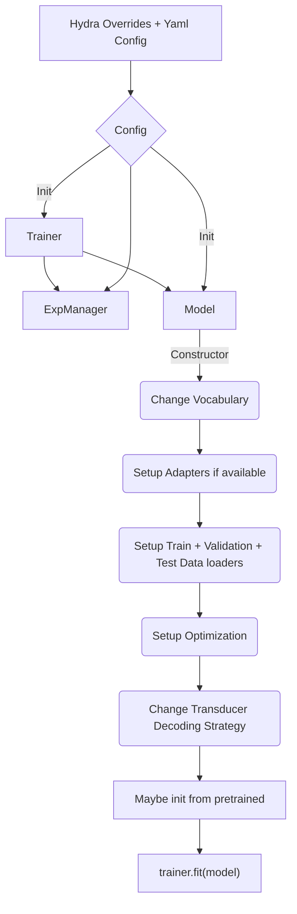

# ASR with Transducer Models

This directory contains example scripts to train ASR models using Transducer Loss (often termed RNNT Loss). 

Currently supported models are - 

* Character based RNNT model
* Subword based RNNT model
* Experimental [enrollment-conditioned target-speaker RNNT](README_target_speaker_asr.md)

# Model execution overview

The training scripts in this directory execute in the following order. When preparing your own training-from-scratch / fine-tuning scripts, please follow this order for correct training/inference.

During restoration of the model, you may pass the Trainer to the restore_from / from_pretrained call, or set it after the model has been initialized by using `model.set_trainer(Trainer)`.
